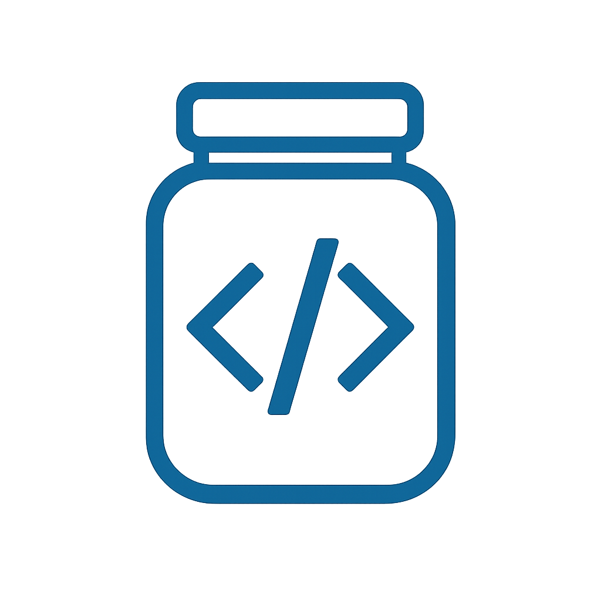

<h1 align="center">Syncjar</h1>

<p align="center">
  <strong>Edit, preview, and sync Skilljar course content locally.</strong>
</p>

<p align="center">
  The local-first Skilljar workflow tool for developers, course authors, and content pros.
</p>

<p align="center">
  <a href="https://kallewesterling.github.io/syncjar/"><strong>Documentation</strong></a>
</p>

---

**Syncjar** is a command-line tool that lets you pull, edit, preview, and sync course content from [Skilljar](https://www.skilljar.com/) — all from your local development environment.

It's your local **Skilljar workspace**: Write content, test changes, see diffs, and push updates upstream.

---

## ✨ Key Features

- 🔁 **Two-way sync** between Skilljar and local files
- ✍️ **Edit each Skilljar content-item** as a standalone HTML file
- 🔍 **Visual diffs** before syncing changes
- 🧪 **Local preview** mode for testing courses offline
- 💾 Uses the Skilljar API with simple setup

---

## 🗂 Folder Structure

```bash
.
├── local-skilljar/
│   └── <course-slug>/
│       ├── details.json
│       ├── lessons-meta.json
│       └── lessons/
│           └── <lesson-slug>/
│               └── content-<content_item_id>.html
│
├── local-skilljar-paths/
│   └── <path-title>/
│       ├── details.json             # The learning path itself
│       ├── path-items.json          # Its member courses
│       └── published.json           # Per-domain slugs
│
├── local-skilljar-quizzes/
│   └── quiz-<quiz_id>.json          # One quiz: settings, questions, answers
│
├── bin/syncjar.mjs                  # The global `syncjar` command
│
├── public/
│   ├── courses/                     # Local preview output
│   └── data/
│       └── courses.json             # Course structure for preview UI
│
├── src/
│   ├── commands/                    # One file per npm script; runs on import
│   │   ├── pull/                    # pull (index.mjs), pull:slugs, pull:paths
│   │   ├── push/                    # push (index.mjs), push:quizzes, push:course-settings
│   │   ├── export/                  # export:plaintext, :users, :metrics, :students
│   │   ├── check/                   # check:links, check:membership
│   │   ├── group/                   # group:audit, :revoke, :add, :remove, :domains
│   │   ├── sync/                    # sync:users
│   │   ├── generate/                # generate:courses
│   │   └── serve.mjs                # serve
│   └── lib/                         # Importable modules; nothing runs on import
│       ├── skilljar/                # API client and paginated list reads
│       ├── content/                 # The local course, lesson and quiz trees
│       ├── push/                    # Push planning, state, diffs, quiz plans
│       ├── groups/                  # Group audit and membership logic
│       └── paths.mjs, ui.mjs, …     # Shared helpers
│
├── test/                            # node --test; imports lib as #lib/*
│
├── .env                             # API key
└── README.md
```

## 🚀 Setup

Clone the repo and install dependencies:

```bash
git clone https://github.com/<your-org>/syncjar.git
cd syncjar
npm install
```

2. Add your Skilljar API key to a .env file:

```env
SKILLJAR_API_KEY=sk-live-abc123
```

3. Pull your Skilljar content and generate the local preview index:

```bash
npm run build:preview
```

### Installing the `syncjar` command

To run Syncjar from any directory without a clone, install it globally from
GitHub:

```bash
npm install --global github:kallewesterling/syncjar#main
```

Every npm script below is then a subcommand, taking the same options:

```bash
syncjar help                              # list commands
syncjar export:students --out roster.csv  # = npm run export:students -- --out roster.csv
syncjar update                            # install the latest main from GitHub
syncjar update --ref dev                  # or any branch, tag or commit
syncjar update --force                    # reinstall even if it's already installed
```

`syncjar update` looks up the commit the ref points at and does nothing if
that commit is already installed. It goes by commit rather than version,
because every commit on a branch carries the version of the last release.
The first update after a plain `npm install --global` always installs, since
npm keeps no record of which commit it installed; `update` keeps one from
then on.

It also reads `package.json` at that commit before installing, and refuses a ref that doesn't provide the `syncjar` command, because
installing one would remove the command and leave nothing to update from.
From a clone, including one linked with `npm link`, it refuses outright and
asks you to `git pull` instead.

Credentials come from a `.env` in the current directory, then from
`~/.config/syncjar/.env` (`$XDG_CONFIG_HOME/syncjar/.env`, or
`%APPDATA%\syncjar\.env` on Windows). A variable set in the shell wins over
both. Put the user-level file somewhere only you can read:

```bash
mkdir -p ~/.config/syncjar && touch ~/.config/syncjar/.env && chmod 600 ~/.config/syncjar/.env
```

Outside a clone, default outputs such as `public/data/` and `local-skilljar/`
are written under the current directory, never into the install, which the
next `syncjar update` replaces. The preview commands (`serve`,
`generate:courses`, `build:preview`, `check:links`) only run from a clone.

## 📋 Available Commands

| Command | Description |
|---|---|
| `npm run pull` | Pull all courses from Skilljar to local files |
| `npm run pull -- --course <slug>` | Pull a single course (partial match on directory name or title) |
| `npm run pull:slugs` | Pull each course's per-domain URL slugs |
| `npm run pull:paths` | Pull learning paths, their member courses, and their per-domain slugs |
| `npm run pull:paths -- --path <query>` | Pull a single path (partial match on directory name or title) |
| `npm run push` | Push local edits back to Skilljar (with diffs + prompts) |
| `npm run push:quizzes` | Create quizzes from `quiz-new-*.json` files, and push edits to pulled `quiz-<id>.json` files |
| `npm run push:course-settings` | Push course settings (sequential navigation, course-time display, labels) from each `details.json` |
| `npm run push:paths` | Push path titles, descriptions, header and item naming from each path's `details.json` |
| `npm run push:lesson-settings` | Push lesson `optional`, description and tooltip from `lessons-meta.json` |
| `npm run push:published-settings` | Push per-domain `hidden` and group visibility from `published.json` |
| `npm run check:settings` | Report courses and paths whose settings differ from the rest (read-only) |
| `npm run check:drift -- [--since <date or ref>] [--course <query>] [--json]` | List lessons and courses edited in the Skilljar dashboard since the last pull; exits 2 if any were (read-only, API v2) |

| `npm run check:visibility -- [--group <name>] [--domain <name>]` | Report which groups can see which published courses and paths, per domain, and flag likely mistakes (read-only, API v2) |
| `npm run generate:courses` | Regenerate the local preview index |
| `npm run build:preview` | Pull + generate (full refresh) |
| `npm run serve` | Start the local preview server at http://localhost:3000 |
| `npm run export:plaintext` | Export course content as Markdown |
| `npm run export:users -- --internal-domain <domain>` | Export Skilljar users to CSV, flagging users at `<domain>` as internal (or set `SYNCJAR_INTERNAL_DOMAIN`) |
| `npm run export:metrics` | Export course metrics to CSV |
| `npm run export:students` | Export the flat Skilljar student list to CSV |
| `npm run export:analytics -- [--by-domain]` | Export each course's enrollments, completions and certificates to CSV, optionally per domain (API v2) |
| `npm run export:enrollments -- [--course <q>] [--email-domain <d>]` | Export one row per enrollment, with student, progress and certificate, to CSV (API v2) |
| `npm run check:links` | Check for broken links in course content |
| `npm run check:membership -- --group <id>` | Report whether users are still in a student group (read-only) |
| `npm run sync:users` | Sync user data from Skilljar |
| `npm run group:audit -- --group <id> --roster <csv>` | List group members who are not on a roster (read-only) |
| `npm run group:revoke -- --in <csv> --group <id>` | Revoke access for a reviewed list of users |
| `npm run group:add -- --group-name <name> --in <csv>` | Add existing students to a group, by email (API v2; dry run unless `--confirm`) |
| `npm run group:remove -- --group-name <name> --in <csv>` | Remove students from a group, by email (API v2; dry run unless `--confirm`) |
| `npm run group:domains -- --group-name <name> [--add <domain>] [--remove <domain>]` | List or change a group's auto-add email domains (API v2; dry run unless `--confirm`) |
| `npm run whoami -- [--json]` | Show the API v2 client's scopes and which commands it can run (read-only) |

| `npm run enroll:add -- --course <id\|title> [--domain <name>] --in <csv>` | Enroll existing students in a course, by email (API v2; dry run unless `--confirm`) |
| `npm run enroll:remove -- --course <id\|title> [--domain <name>] --in <csv>` | Deactivate students' enrollments in a course, by email (API v2; dry run unless `--confirm`) |
| `npm test` | Run the unit tests |

### Group membership (API v2)

`group:add` and `group:remove` use Skilljar's v2 API, not the v1 key. They
need an OAuth client with exactly three scopes: `student-groups:read`,
`student-groups:write` and `students:read`, the last for looking students up
by email. Such a client cannot touch content, enrollments or accounts, so it
is the one to hand to someone who should not hold the v1 key. It is broader
than membership, though: `student-groups:write` also renames groups, rewrites
their auto-add domains, changes which courses they can see, and deletes them.
Syncjar's commands do none of that except `group:domains`, but whoever holds
the credentials can call the API directly.

```env
SKILLJAR_CLIENT_ID=...
SKILLJAR_CLIENT_SECRET=...
```

```bash
# Dry run: reads only, and shows who would be added
syncjar group:add --group-name "Partner: Acme" --in acme.csv

# Do it: asks you to type "add <n>" first
syncjar group:add --group-name "Partner: Acme" --in acme.csv --confirm

# A few addresses without a file; --group takes the v2 group id instead
syncjar group:remove --group <id> --email a@acme.com --email b@acme.com --confirm
```

`--in` is a CSV with an `email` column, or one address per line. Nobody is
created: an email with no Skilljar account is listed and skipped. Each
confirmed run writes an audit CSV to `public/data/` under the current
directory, holding names and addresses, so delete it when you are done.

The v2 API cannot list a group's members. So an add reports who was already
a member only after it runs, and a remove reports everyone sent as removed,
whether or not they were in the group.

### Course analytics (API v2)

`export:analytics` writes Skilljar's own per-course summary to
`public/data/course-analytics.csv`: enrollments, completions, completion
rate, certificates issued and ratings. It needs `courses:read` and
`analytics:read`, plus `domains:read` for the per-domain options:

```bash
syncjar export:analytics                                 # one row per course
syncjar export:analytics --by-domain                     # plus a row per course per domain
syncjar export:analytics --domain courses.example.com    # plus one domain only
```

The figures are aggregates; there is nothing per student, lesson or quiz.
Unlike `export:metrics`, it needs no `sync:users` first. A per-domain
run makes one request per course per domain, so it takes about a minute.

### Enrollments (API v2)

`export:enrollments` writes one row per enrollment to
`public/data/enrollments.csv`: course, Skilljar domain, the student's email
and name, when they enrolled and completed, progress and success status,
score, certificate, source (self-enrolled, purchased or assigned) and
whether the enrollment is active. It needs `enrollments:read`,
`published-courses:read` and `courses:read`, `domains:read` for `--domain`,
and `analytics:read` for the cross-check below. Whether it also needs
`students:read` for the student columns is untested.

```bash
syncjar export:enrollments                                          # every enrollment
syncjar export:enrollments --course "first build" --email-domain example.com
syncjar export:enrollments --domain courses.example.com --completed-only --since 2026-07-01
syncjar export:enrollments --email someone@example.com --include-feedback
```

`--course` matches an id or part of a title, as `pull --course` does, and
`--course`, `--domain`, `--email` and `--email-domain` repeat. `--since` is
the enrolment date, in UTC. `--email-domain` matches the domain exactly:
`example.com` does not include `eu.example.com`, so name each one wanted.
Rating and the free-text feedback are left out unless `--include-feedback`.

When the export is not narrowed by student or date, its counts per course
are compared with the analytics summary, and any difference is reported;
`--no-check` skips that. Every read happens before the file is written, and
a failed one stops the export. The whole organisation takes about a
minute and a half. The file holds names and addresses, so delete it when
you are done.

### Auto-add email domains

A group's email domains put every new student who signs up with an address
at one of them into the group. `group:domains` lists and changes them, and
needs only `student-groups:read` and `student-groups:write`:

```bash
syncjar group:domains --group-name "Partners"                          # list
syncjar group:domains --group-name "Partners" --add acme.com           # dry run
syncjar group:domains --group-name "Partners" --add acme.com --confirm # do it
syncjar group:domains --group-name "Partners" --remove old.example --confirm
```

The domain rules apply at signup only. Students who already have an account are
not added, so pair a new domain with `group:add` for them.

The v2 API can only replace a group's whole domain list, not add one
domain. So a confirmed run reads the list again just before writing and
stops if it changed since the plan was shown, writes the merged list, and
reads it back. It prints the previous list afterwards, so a mistake can be
undone by hand. Free-mail domains such as `gmail.com` are refused unless
you pass `--allow-public-domain`.

### Which commands can this client run?

A v2 client that lacks a scope gets a 403 from the first call that needs
it, which can be partway through a run. `whoami` checks up front: it
exchanges `SKILLJAR_CLIENT_ID` and `SKILLJAR_CLIENT_SECRET` for a token,
reads the client id, organisation, token lifetime and scopes out of it, and
lists every v2 command as runnable or with the scopes it is missing. The
commands that need `SKILLJAR_API_KEY` instead are listed after, with
whether it is set.

```bash
syncjar whoami          # for people
syncjar whoami --json   # for scripts
```

The scope names come from the token itself, because Skilljar's token
response does not include them. `whoami` makes no request beyond the token
exchange and never prints the token or the secret. A client shown as able
to run the group commands is not limited to membership:
`student-groups:write` also renames and deletes groups and changes their
domains and course visibility (see [Group membership](#group-membership-api-v2)).

The scopes each command needs are listed in `src/lib/skilljar/v2-scopes.mjs`,
and the tests fail if a v2 command is missing from it.

### Course enrollments (API v2)

`enroll:add` enrolls existing students in a course by email, and
`enroll:remove` deactivates their enrollments. A deactivated enrollment is
not deleted: it keeps its progress, and v2 has no way to delete an
enrollment, but the learner loses access and the course shows as "Inactive"
on their dashboard. Analytics still counts it. Neither command uses `PATCH /enrollments/completion`, which would
mark learners as having completed a course they did not complete. The
commands need an OAuth client with `courses:read`, `published-courses:read`,
`domains:read`, `students:read`, `enrollments:read` and `enrollments:write`.

```bash
# Dry run: reads only, and shows who would be enrolled and who is skipped
syncjar enroll:add --course "Getting started" --domain courses.example.com --in acme.csv

# Do it, with an expiry: asks you to type "enroll <n>" first
syncjar enroll:add --course <id> --domain courses.example.com --in acme.csv --expires-at 2027-01-31 --confirm

# Deactivate: asks you to type "unenroll <n>" first
syncjar enroll:remove --course <id> --domain courses.example.com --email a@acme.com --confirm

# Someone deactivated wants back in: a fresh start, or their old progress
syncjar enroll:add --course <id> --email a@acme.com --re-enroll --confirm
syncjar enroll:add --course <id> --email a@acme.com --restore --confirm
```

Every published course keeps progress per enrollment
(`unique_progress_per_enrollment`), so the two differ. `--re-enroll` gives
the student a new enrollment that starts from no progress, and the old one
stays as history: the admin's student page then shows only the new one,
while the API still returns both. `--restore` makes the old enrollment
active again, with its progress, as if it had never been deactivated, and
refuses a student who already has more than one enrollment in the course.
`--expires-at` cannot be combined with `--re-enroll`, because Skilljar
answers that with an internal error, and it does not apply to a restore.

An enrollment belongs to a course *on one domain*, so `--domain` is required
when the course is published on more than one. `--course` takes the v2
course id or the exact title. Every email is looked up first, along with that
student's enrollment in the course on that domain. Nobody is created, and
some emails are skipped:

| Skipped | `enroll:add` | `enroll:remove` |
|---|---|---|
| No Skilljar account, or more than one | ✓ | ✓ |
| Already actively enrolled | ✓ | — |
| Enrollment deactivated | unless `--re-enroll` (a new enrollment, from no progress) or `--restore` (the old one, with its progress) | ✓ (already inactive) |
| Enrollment expired | ✓ | ✓ (already inactive) |
| More than one enrollment in the course on that domain, with `--restore` | ✓ | — |
| Deactivated account | ✓ | — |
| Not an active member of the domain | ✓ | — |
| Not enrolled | — | ✓ |
| More than one active enrollment in the course on that domain | — | ✓ |

The expired-enrollment, domain-member and deactivated-account skips stay
until someone tests what Skilljar does with those students. A confirmed run
sends batches of 100 and stops at the first batch that fails as a whole.
Afterwards it reads every student's enrollment back: a row counts as done
only when the read-back matches what was meant (a new active enrollment,
with the requested expiry; the old enrollment active again and alone, for a
restore; the targeted enrollment inactive, for a remove). The audit CSV in
`public/data/` records each email's state before and after, including the
learner's progress. It holds names and addresses, so delete it when you are
done.

Paths have no enrollments in v2; these commands handle courses only.

## 🗃 Course Directory Names

A course's directory name comes from its **course id**, not its title.

`npm run pull` reads the `id` in every `details.json` under the content path and
builds a map of course id to directory name. A course that already has a
directory keeps that directory's name exactly, even after someone rewords or
re-cases its title in Skilljar. Only a course id that is new to the tree gets a
name derived from its title.

This is what stops a renamed course from gaining a second directory. It also
keeps the tree safe on macOS, where two names that differ only in case cannot
coexist.

To rename a course directory, rename it yourself. The next pull follows the new
name, because it matches on the id.

## 🛑 Interrupting a pull

It's safe to stop `pull`, `pull:slugs` or `pull:paths` partway with Ctrl+C,
or for CI to cancel one. Every file is written to a temp file in the same
directory and then renamed into place, so each file is either the old version
or the new one, never partly written or empty. An interrupted pull can leave
some files updated and others not, so run it again before committing.

A run that is killed can leave temp files named
`.<file>.syncjar-<hex>.tmp`. They are dotfiles, and they don't end in `.html`
or `.json`, so nothing reads them as content. The next pull removes them.

`pull` also won't replace a content file that has content with an empty one
on a single read. When Skilljar's content list returns an item empty and the
local file has content, pull reads that item again on its own:

- If the second read has content, pull writes that.
- If the second read is empty too, Skilljar really has the item empty. Pull
  writes the empty file and warns, so check the lesson before committing.
- If the second read fails, or has no content field, pull keeps the existing
  file, warns, and exits non-zero.

## Quizzes

`npm run pull` also writes quizzes, one file per quiz, to
`local-skilljar-quizzes/quiz-<quiz_id>.json`. Each file holds the quiz's
settings and its questions in order, with each question's answers and which
of them are correct.

Quizzes get their own directory rather than living inside a course, because
one quiz is often linked from lessons in several courses. A lesson points at
its quiz through `non_html_items` in `lessons-meta.json`:

```json
"non_html_items": [
  { "id": "<content_item_id>", "type": "QUIZ", "order": 1, "content_quiz_id": "<quiz_id>" }
]
```

A full pull writes every quiz in the organisation, including ones no lesson
links to, and lists those. `--course` writes only that course's quizzes.

**Deleting a course doesn't delete its quizzes.** A quiz belongs to the
organisation, not to a course. When you delete a course in Skilljar, its
quizzes stay, and so, through the API, do its lessons. The next full pull still
writes those quizzes, and lists them as not linked from any lesson. If you
don't want them, delete them in Skilljar. See `CLAUDE.md` ("Quiz writes") for
the API cleanup.

Set `QUIZ_CONTENT_PATH` to write somewhere else:

```env
QUIZ_CONTENT_PATH=../courses/quizzes
```

### Writing a new quiz

Create `quiz-new-<anything>.json` in the quiz directory. The easiest start is
to copy a pulled quiz file and delete every `"id"` line. The rest of a pulled
file is accepted as it is. A minimal quiz:

```json
{
  "name": "Sample: container basics check",
  "html": "<p>Three questions on the lesson you just read.</p>",
  "passing_percentage_correct": 70,
  "questions": [
    {
      "type": "MULTIPLE_CHOICE",
      "html": "<p>Which file lists an image's packages?</p>",
      "answers": [
        { "answer_text": "An SBOM", "correct": true },
        { "answer_text": "A Dockerfile", "correct": false }
      ]
    }
  ]
}
```

Question types are `MULTIPLE_CHOICE` (exactly one correct answer),
`MULTIPLE_ANSWER` (one or more), `FILL_IN_THE_BLANK` (every answer is an
accepted answer, so each is `"correct": true`), and `FREEFORM` (no answers).
Questions appear in the order they are listed.

Then:

```bash
npm run push:quizzes -- --dry-run   # validate, and show what would be created
npm run push:quizzes                # create, asking about each quiz
```

Every new quiz file is checked before anything is created, and one that fails
stops the run. Unknown fields are errors,
because Skilljar silently ignores fields it doesn't recognise, so a typo would
otherwise lose a setting without telling you. Each quiz is read back after
it's created and compared with the file. If anything differs, or a request
fails, the half-made quiz is deleted. On success, the draft is replaced by
the pulled form, `quiz-<id>.json`.

A new quiz is **not attached to any lesson** unless you ask, so learners can't
see it yet. Add it to its lesson in Skilljar, or name the lesson when you
create it:

```bash
npm run push:quizzes -- --file quiz-new-sbom-basics.json --attach <lesson_id>
```

A lesson's id is in its course's `lessons-meta.json`. `--attach` only works
with `--file`, so it's always clear which quiz goes where. It can't be undone
through the API, because Skilljar has no API for removing a content item. To
detach a quiz, remove it in the Skilljar UI.

Like `push`, `push:quizzes` only writes from a content repo on `dev` or `main`
(`--allow-branch` to override). It refuses a quiz whose name already exists in
Skilljar, since that usually means an earlier run created it.

### Editing a quiz

Edit a pulled `quiz-<id>.json` and run `npm run push:quizzes`. It compares
the file with Skilljar and shows each change before making it. There are two
kinds of change, and they matter differently to learners who already took the
quiz:

| Change | How it's made | Learners who took the quiz |
|---|---|---|
| Quiz settings; a question's text, type, feedback or grading flags | Edited in place | The question keeps its response history |
| A question's answers, or its position; adding a question anywhere but the end | The question is recreated, and so is every question after it | Those questions' response history is dropped from quiz analytics, and learners can no longer review their past answers. Scores and completions are kept. |
| Removing a question | Deleted | Same as above, for that question |

Skilljar can't change answers or question order in place, which is why the
second kind recreates questions. A new question always goes to the end, so
keeping the file's order means recreating everything after the first change.

In-place edits are prompted, and `--force` skips the prompt. Anything that
recreates or removes questions is all-or-nothing per quiz. It needs either an
interactive yes or `--recreate <quiz_id>` for that quiz, and `--force` never
covers it. New questions are created before old ones are deleted, so a
failure partway leaves extra questions rather than missing ones. Every edit is
read back and verified, and the file is rewritten with Skilljar's new ids.

A quiz file that hasn't changed since its last verified push is skipped
without a request. `--full-scan` compares everything. The record is kept in
`.syncjar-quiz-state.json`, and a missing or deleted state file only means a
slower run.

A pulled file is held to the same checks as a new quiz, but only when it
differs from Skilljar, because only then is anything written. Skilljar has
quizzes these checks reject: feedback forms with `LINEAR_SCALE` questions,
survey questions with no correct answer, quizzes with no description, and
empty "Untitled Quiz" shells. Left as pulled, they are listed as warnings and
never block a push. Once edited, a quiz that fails the checks is refused on
its own, and the rest of the run goes ahead. So a quiz with a `LINEAR_SCALE`
question can't be pushed from here, even if the edit is to another question.
Edit it in Skilljar.

See `CLAUDE.md` ("Quiz writes") for what the Skilljar API does and doesn't
allow.

## 🧭 Learning Paths

Skilljar models a learning path much like a course, so `npm run pull:paths`
mirrors the same three objects per path into `local-skilljar-paths/<path>/`:

| File | Source | Contents |
|---|---|---|
| `details.json` | `GET /paths` | The path itself, verbatim: title, descriptions, promo image, item count |
| `path-items.json` | `GET /paths/{id}/path-items` | Its member courses, verbatim |
| `published.json` | `GET /domains/{domain}/published-paths` | Per-domain slug, publish id, and hidden flag |

Directory naming follows the same id-not-title rule as courses, for the same
reason — see the section above.

Set `PATH_CONTENT_PATH` in `.env` to write somewhere else (for example, into a
content repo alongside `COURSE_CONTENT_PATH`):

```env
PATH_CONTENT_PATH=../courses/paths
```

Slugs are per-domain, so `published.json` needs to know which domains to ask
about — the same `SKILLJAR_DOMAINS` (or `--domain`) that `pull:slugs` uses. A
run with neither configured still writes `details.json` and `path-items.json`,
and says it is skipping `published.json`.

```bash
npm run pull:paths                               # everything
npm run pull:paths -- --path "onboarding"        # one path
npm run pull:paths -- --dry-run                  # print, write nothing
npm run pull:paths -- --check                    # CI: non-zero exit if any file is stale
```

Two caveats worth knowing before you build anything on the output:

- **`path-items.json` is membership, not a running order.** The API returns no
  order field, and the order it does return is not display order. The file
  preserves API order and claims nothing more.
- **A path id belongs to one domain on some instances and several on others.**
  `published.json` is keyed by domain either way, so it represents both without
  assuming. If your instance has separate path objects per domain, note that
  two different path ids can share a slug, and only the slug is common to both.

`npm run push` syncs course and lesson content and leaves paths alone. Path
titles, descriptions and item naming have their own command,
`npm run push:paths` (see "Path details, lesson settings and visibility").

## 🔁 Sync Local Edits Back to Skilljar

After editing any content file in `local-skilljar/<course>/lessons/<lesson>/content-<content_item_id>.html`, run:

```bash
npm run push
```

This will show diffs and prompt before updating content upstream.

`push` writes course titles, lesson titles and content items. It does not read
the settings in `details.json`, so changing one there and running `push`
reports nothing to do. Settings have their own command.

### Course settings

`npm run push:course-settings` pushes course-level settings from each course's
`details.json`. It handles these fields:

| Field | Value |
|---|---|
| `enforce_sequential_navigation` | `true`/`false`. Details → Settings → Lesson Navigation → "Enforce sequential navigation" |
| `display_course_and_lesson_time` | `true`/`false`. Show course and lesson times |
| `display_manual_course_time` | `true`/`false`. Show the manual course time instead |
| `labels` | A list of label names, which must already exist in Skilljar. Order doesn't matter |

Edit them in `details.json`, then:

```bash
npm run push:course-settings -- --dry-run          # each course's before and after
npm run push:course-settings                       # same list, one prompt, then write
npm run push:course-settings -- --course <dir|id>  # only this course (repeatable)
```

The dry run is a single `GET /courses`, plus `GET /labels` when a course
names a label. A label that Skilljar doesn't have is refused with a warning
rather than sent. A real run sends one `PATCH /courses/{id}` per course,
holding only the changed fields, so the title and descriptions are never sent.
Afterwards it reads the catalog again. If a value didn't land, or any other
field on a written course changed, it lists the problem and exits 1. The
exceptions are `modified_at`, and `course_time` when a display flag was
written, since Skilljar recomputes both.

Other course settings stay out on purpose. The short description, the manual
course time text and the time format can be set through the API but never
cleared again. Per-domain visibility lives in `published.json` and has its
own command (below). See `CLAUDE.md` ("Settings writes") for what was
tested.

Local wins: a course switched in the dashboard but not in `details.json` shows
up as a change back. Pull first if that might have happened. Like `push`, it
only writes from a content repo on `dev` or `main` (`--allow-branch` to
override), and `--force` skips the prompt.

Writing a setting bumps the course's `modified_at`, so the next `push` scans
those courses once instead of skipping them.

### Path details, lesson settings and visibility

Three more commands work the same way: the same `--dry-run`, one prompt
(`--force` to skip it), the same branch guard, a `PATCH` holding only the
changed fields, and a read-back that exits 1 if anything else moved.

| Command | Writes | From | Narrow with |
|---|---|---|---|
| `npm run push:paths` | A path's title, short and long description, header, and what it calls its items (`course_name_singular`, `course_name_plural`) | each path's `details.json` | `--path <dir\|id>` |
| `npm run push:lesson-settings` | Whether a lesson is `optional`, its `description_html`, its `tooltip_html` | each course's `lessons-meta.json` | `--course <dir\|id>` |
| `npm run push:published-settings` | `hidden` and `strict_enforce_group_visibility`, per domain | each course's and path's `published.json` | `--domain <host>` |

- `push:paths` reads `PATH_CONTENT_PATH`, which `pull:paths` writes.
- `push:lesson-settings` costs one lesson list per course. Lesson titles stay
  with `push`.
- `push:published-settings` needs `published.json` files that record
  `strict_enforce_group_visibility`. `pull:slugs` and `pull:paths` write it
  from this version on, so rerun them first. Until then a file without the
  field has no opinion about it. Slugs are in the same file and are never
  written.
- **Hiding a path's last visible course closes registration on that path.**
  `push:published-settings` warns before the prompt when a run would do that.

### Checking for odd settings

`npm run check:settings` is read-only. For each course, published course, path
and published path setting, it finds the value most records use. If one
value covers at least 90% of them (`--threshold`), it lists every record that
differs, which is usually a dashboard slip. Settings that are genuinely split,
such as `hidden`, are shown as varying rather than flagged. Nothing is
hardcoded, so the norm is whatever your catalog does.

```bash
npm run check:settings                                   # report
npm run check:settings -- --domain courses.example.com   # one domain
npm run check:settings -- --fail-on-outliers             # exit 1 if anything is flagged, for CI
```

Domains come from `--domain`, then `SKILLJAR_DOMAINS`, then every domain the
key can see.

### Checking for dashboard edits before a push (API v2)

`push` overwrites Skilljar with the local tree, so a lesson edited in the
Skilljar dashboard since the last pull loses that edit. A dashboard edit
does move the course's `modified_at`, but that only says the course changed,
not what or when relative to the last pull. `check:drift` reads Skilljar's audit log instead, which records dashboard
actions and not API writes, so a push's own writes never show up in it.

```bash
syncjar check:drift                         # since the last pull commit in the content repo
syncjar check:drift --since 2026-10-01      # since a date (UTC)
syncjar check:drift --since 59f6afa1        # since a commit in the content repo
syncjar check:drift --course launchpad      # only local courses whose directory, id or title matches
syncjar check:drift --json                  # machine-readable
```

By default it starts from the newest commit in `COURSE_CONTENT_PATH`'s repo
whose subject says it synced or pulled from Skilljar (`chore(content): sync
Skilljar → courses/`, `Sync Skilljar content`, `content: pull …`). It does not
start from the newest commit of any kind: a local edit committed after a
dashboard edit would move the start past that edit and hide it. A commit that
recorded dashboard edits by hand under another subject makes them show up
again; pass `--since <that commit>` to start after it.

The report is grouped by course and then lesson, one line per kind of change
with a count and a date range. Lesson content edits (`HTML`, `VIDEO`, `QUIZ`,
downloads) are marked `!` and come first, because those are what a push
destroys. Creations, deletions, reorders and publishes are marked `~`; titles,
descriptions and flags `·`. Lessons and courses missing from the local tree are
looked up, and reported as new upstream, never pulled, or deleted.

Exit codes: `0` nothing was edited, `2` something was, `1` an error. So run it
before a push, and stop if it exits 2:

```bash
syncjar check:drift && syncjar push
```

It needs an API client with `audit:read`, plus `lessons:read` and
`courses:read`. It makes GET requests and runs `git log`, nothing else. The
audit log names the dashboard user behind each event; the report leaves them
out. `--show-actors` adds them in an interactive terminal only, and is refused
with `--json` or when output is not a terminal, so they cannot end up in a CI
log or a file.

### Checking who can see what

`syncjar check:visibility` is read-only and uses the v2 API. It needs a client
with `domains:read`, `student-groups:read`, `published-courses:read` and
`paths:read`. For each domain it lists the published courses and paths that
are restricted (hidden, strict enforcement on, or carrying group rules) and
says in plain words who can see each one. Then it lists what each group
unlocks, and then likely mistakes:

- overrides on unpublished courses, or on courses that no longer exist;
- a hidden course or path with strict enforcement and no allowed group, which
  nobody can see;
- a path listed for an audience that can see none of its courses, which
  closes its registration;
- a restricted course inside a path that more people can see.

```bash
syncjar check:visibility                                          # every domain and group
syncjar check:visibility --domain courses.example.com --group Partners
syncjar check:visibility --json                                   # the whole model, for scripts
syncjar check:visibility --out                                    # also public/data/visibility.csv
```

Each record is judged for "(everyone)", meaning anyone in none of its groups
(anonymous visitors included), and for each group, as one of: `listed` (shows
in the catalog), `link-only` (not listed, but a direct link opens it),
`blocked`, or `unpublished`. Hidden decides the catalog listing. Strict
enforcement decides whether a direct link still works. The command does not
model `CATEGORY` visibility, and does not work out what a student in several
groups sees. It says so where that applies. Exits 0 whatever it finds.

## 🛠️ Example Workflows

### 🔄 Pull and refresh everything (Skilljar → local)

```bash
npm run build:preview
```

Runs:

```
npm run pull
npm run generate:courses
```

### 📝 Edit content locally and preview it

After these scripts have run, you can edit the .html files in `local-skilljar/<course>/lessons/<lesson>/`.

After you make changes, you need to rebuild the local preview index:

```bash
npm run generate:courses
```

Then you can preview the content:

```bash
npm run serve
```

This starts a local server at [http://localhost:3000](http://localhost:3000). Each lesson is rendered inside an iframe as a full HTML document, so Skilljar theme styles and scripts are applied accurately.

## 🎨 Theming

Copy `preview.config.example.json` to `preview.config.json` at the project root, and fill in your Skilljar domain and theme URLs. `preview.config.json` is gitignored, so your real URLs stay out of the repo:

```json
{
  "baseURL": "https://your-skilljar-domain.com",
  "theme": {
    "css": [
      "https://your-skilljar-domain.com/path/to/theme.css"
    ],
    "js": [
      "https://your-skilljar-domain.com/path/to/theme.js"
    ]
  }
}
```

The preview server injects these into each lesson iframe at render time. Leave the arrays empty, or skip the file entirely, to preview unstyled content.

### 📤 Push changes upstream (local → Skilljar)

```bash
npm run push
```

With options:

```bash
# Dry run with diffs
npm run push -- --dry-run

# Push a specific lesson
npm run push -- --course This-Is-My-Course-Title --lesson 03-wrap-up

# Show diffs only (no syncing)
npm run push -- --diff-only

# Push content-item HTML changes without prompting
npm run push -- --force

# Push course/lesson title changes without prompting (separate from --force)
npm run push -- --force-titles

# Push without showing diffs
npm run push -- --no-diff

# Change how many read requests the scan runs at once (default 6)
npm run push -- --concurrency 3

# Force a diff layout (default: auto)
npm run push -- --diff-style stacked
npm run push -- --diff-style side-by-side

# Scan everything, ignoring what was recorded as already in sync
npm run push -- --full-scan
```

#### Skipping courses that haven't changed

`push` records which courses it has verified as in sync, in
`.syncjar-push-state.json` (gitignored). On the next run a course is skipped
outright — no requests for it at all — when **both**:

- its local content hashes to what it hashed to then, and
- the course's upstream `modified_at` is what it was then.

The second is free: `push` already fetches the whole catalogue in one request,
and the timestamp comes with it.

In practice that is the difference between scanning 66 courses and scanning
the one or two you actually edited:

```
Scanning 66 course(s)…
   65 course(s) unchanged since the last push — skipped without a request
   1 course(s) scanned: 42 item(s) in sync, 2 change(s) found in 4.9s
```

**105 seconds to 5.** Measured on the full catalogue.

Anything unknown falls through to a full scan: no state file, a changed hash,
a moved timestamp, a state file from an older version of the tool. Deleting
`.syncjar-push-state.json` is always safe — the next run just scans
everything. `--full-scan` does the same without deleting it, and `--lesson`
disables skipping too, since the hash covers a whole course. (`--no-skip` is
still accepted as the old name for `--full-scan`.)

A run that skipped everything says so, rather than claiming to have checked:

```
   66 course(s) unchanged since the last push — skipped without a request
✓ Nothing to push — 66 course(s) skipped, no content compared.
```

"Everything is in sync" is reserved for runs that actually compared content
against Skilljar. After a push, "did that land?" is a fair question to ask,
and only `--full-scan` answers it honestly.

A course is only recorded once it is *fully* in sync. Decline one prompt and
it stays unrecorded, so the rest of its changes are still there next run.

##### Is it safe?

Yes, and not because the timestamp is trustworthy. **A skipped course is never
written to.** The worst a wrong skip can do is fail to *report* that someone
edited that course in the Skilljar web UI — it cannot overwrite that edit,
because it does no writes at all. Reconciling upstream edits is `pull`'s job,
and once a pull brings one down, the local hash changes and the course is
scanned again.

Worth comparing against the behaviour this replaces: on finding such an edit,
`push` used to offer to overwrite the newer upstream copy with the older local
one. Skipping is the more conservative of the two.

#### Reading a diff

Content diffs are shown in two columns, Skilljar on the left and your local
copy on the right, with the changed words highlighted in place:

```
  Skilljar (upstream)                          │   local
───────────────────────────────────────────────┼───────────────────────────────────────────────
  ⋯ 6 unchanged line(s) ⋯
  </li>                                        │   </li>
- <li>Automate image updates in CI/CD          │ + <li>Automate image updates everywhere CI/CD
  </li>                                        │   </li>
  ⋯ 1 unchanged line(s) ⋯
```

Both sides are reflowed onto matching lines before being compared, using the
same whitespace rules the sync itself uses — Skilljar and your local copy
indent and wrap the same markup differently, and without that step nearly
every line reads as changed. Inside `<pre>`, whitespace is left exactly as it
is, because there it is content.

Those display lines are produced by the reflow, so they are not file line
numbers and none are shown.

`--diff-style stacked` gives a one-column `-`/`+` view instead, which is what
`auto` falls back to on a terminal narrower than 100 columns.

#### How a push runs

`push` works in two phases. The **scan** compares every local course against
Skilljar and builds a list of changes; it writes nothing, so it runs in
parallel. The **apply** then walks that list, shows each diff and prompts.

So you see the whole change list before the first prompt, rather than having
prompts surface one at a time over the length of the run. Scanning the full
catalogue — 66 courses, 649 lessons, 822 content items — takes about 80
seconds.

If Skilljar starts throttling (the client prints a retry notice and backs
off), lower `--concurrency`. Narrowing the scan with `--course` or `--lesson`
is faster still, since `--lesson` cuts the content reads to a single request.

#### Branch guard

Skilljar holds one live state and knows nothing about git branches. If your course content repo is on a feature branch that's behind `dev`/`main`, pushing from it silently overwrites whatever landed there in the meantime — and git can't catch that, because the danger is entirely in which branch happens to be checked out.

So `npm run push` refuses to run unless your **course content repo** (`COURSE_CONTENT_PATH`) is on `dev` or `main`. A detached HEAD, or a content directory that isn't a git repo at all, is also refused: nothing establishes that the content is current.

`--dry-run` and `--diff-only` never write to Skilljar, so they work from any branch.

```bash
# Push from another branch, naming it explicitly
npm run push -- --allow-branch feat/new-lesson
```

The guard checks *which* branch you're on, not whether it's up to date — pull before you push.

## 🔒 Connect to Your Course Content

This repo does **not** track course content directly. To use it:

1. Clone your private course content repo:

   ```bash
   git clone git@github.com:<YOUR-ORG>/<YOUR-COURSE-CONTENT-REPO>.git ~/courses
   ```

2. Add to the `.env` file in this repo:

   ```
   COURSE_CONTENT_PATH=../courses
   ```

3. Then run:

   ```bash
   npm run build:preview
   ```

This keeps your course content private and portable across environments.
